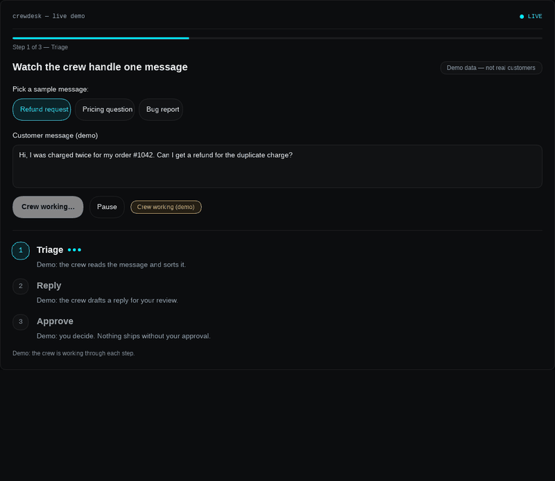

# CrewDesk


**Hire an AI crew for one job. It finishes the work, you approve, it ships.**

CrewDesk is an open-source AI Support Crew for solo SaaS / e-commerce founders: **Triage** (categorise + prioritise P0–P3) → **Reply** (draft from your knowledge base only — never invents prices or policies) → **Escalate** (refunds / angry / out-of-knowledge-base messages go to the founder). Nothing is ever sent without founder approval.

> **Live demo:** https://crewdesk-nine.vercel.app/ — try the inbox simulator in the hero, no signup. Runs on labelled demo data.

## Pricing

| Plan | Price | Replies / day | Inboxes |
| --- | --- | --- | --- |
| Free | $0 forever | 5 | 1 |
| Starter | $19/mo ($15/mo billed annually) | 30 | 2 |
| Growth | $49/mo — coming soon (waitlist) | 30 (when it ships) | 2 (when it ships) |

Prices live in one place: [`lib/site-data.ts`](lib/site-data.ts). Quota counts per reply actually **sent** — drafts, triage, and rejected replies don't use quota.

## Stack

- Next.js 16.4.6 + React 19.3.1 + Tailwind CSS 4.3.5
- `@supabase/supabase-js` 2.119.2 (Auth + Postgres + RLS — project not created yet, see Status)
- Lenis + GSAP for motion
- Fonts via runtime `<link>`: Inter Variable + JetBrains Mono (no `next/font/google`)

## Quickstart

```bash
git clone https://github.com/bangdodonbotak-art/crewdesk.git
cd crewdesk
npm install
npm run dev     # http://localhost:3000
npm run build   # production build
```

Copy `.env.example` to `.env.local` for Supabase keys. Without them the app runs on **labelled demo data** — nothing is live:

- `NEXT_PUBLIC_SUPABASE_URL`, `NEXT_PUBLIC_SUPABASE_ANON_KEY`, `SUPABASE_SERVICE_ROLE_KEY`
- `CREWDESK_INBOUND_ADDRESS` — Gmail inbound-forward address (the MVP ingestion path)

## Screenshots

Demo GIF / screenshots: **TODO — not captured yet.** To add one, save a screen recording of the hero simulator as `docs/simulator.gif` and add this line under this section:

```markdown

```

## What works in this MVP

- Landing (`/`) — hero inbox simulator (auto-plays Triage → Reply → Approve once, then stops at review with Replay + Pause; Approve / Reject / Edit work in demo mode).
- Dashboard (`/dashboard`) — inbox queue P0–P3, Live tab (empty — no real threads yet) + Demo tab (6 labelled demo threads), quota counter.
- Ticket detail (`/inbox/[id]`) — workflow timeline, editable draft, Approve / Reject (demo — no real email is sent).
- Knowledge base (`/knowledge`) — local CRUD + search (browser state only).
- Settings (`/settings`) — plan, quota, inbound address, upgrade-intent recording (demo, no Stripe).
- API (demo only): `POST /api/crew/run`, `POST /api/crew/approve`, `POST /api/inbound`, `POST /api/upgrade-intent`.
- Supabase migration: `supabase/migrations/20261121000000_crewdesk_init.sql` (file only — **not applied anywhere**).

## Project structure

```text
app/          # Next.js App Router pages + API routes
components/   # Inbox simulator, motion provider, reveal animations
lib/          # Site data + pricing (single source of truth), crew engine, quota, Supabase clients
public/       # Logo + icons
supabase/     # SQL migration (not applied yet)
```

## Status (honest)

MVP demo, live at https://crewdesk-nine.vercel.app/.

- The crew engine is a **state machine over labelled demo data**. No real AI model is wired in yet — free-model wiring (Groq / TokenHarbor) is the next step.
- No Supabase project exists yet. Auth (Google OAuth) + RLS + the migration need a new project. Do **not** reuse other paused projects.
- Gmail ingestion is inbound-forward for now. Restricted OAuth scopes need Google verification (weeks + cost).
- Auth sessions don't persist yet — the callback uses `@supabase/supabase-js` directly; `@supabase/ssr` is needed for real cookie sessions.
- No fake metrics, testimonials, or revenue claims anywhere. All demo data is labelled DEMO.

Issues and PRs are welcome — small, focused PRs with a clear description.

## Sponsor

GitHub Sponsors profile for `bangdodonbotak-art` is **being set up and not active yet** — the Sponsor button on this repo will appear once the profile is approved. `.github/FUNDING.yml` is already in place so the button activates automatically at that point.

## License

MIT — see [LICENSE](LICENSE).
