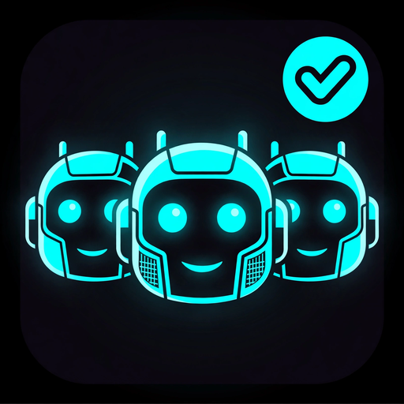
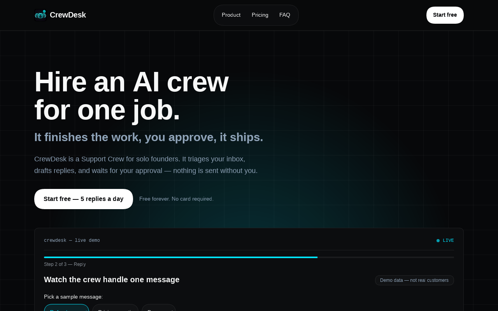
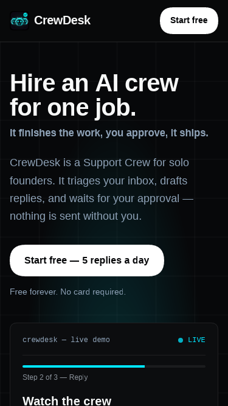

# CrewDesk



**Hire an AI crew for one job. It finishes the work, you approve, it ships.**

CrewDesk is an open-source AI Support Crew for solo SaaS / e-commerce founders: **Triage** (categorise + prioritise P0–P3) → **Reply** (draft from your knowledge base only — never invents prices or policies) → **Escalate** (refunds / angry / out-of-knowledge-base messages go to the founder). Nothing is ever sent without founder approval.

> **Live demo:** https://crewdesk-nine.vercel.app/ — try the inbox simulator in the hero, no signup. Runs on labelled demo data.

## Pricing

| Plan | Price | Replies / day | Inboxes |
| --- | --- | --- | --- |
| Free | $0 forever | 5 | 1 |
| Starter | $19/mo ($15/mo billed annually) | 30 | 2 |
| Growth | $49/mo — coming soon (waitlist) | 30 (when it ships) | 2 (when it ships) |

Prices live in one place: [`lib/site-data.ts`](lib/site-data.ts). Quota counts per reply actually **sent** — drafts, triage, and rejected replies don't use quota.

## Stack

- Next.js 16.4.6 + React 19.3.1 + Tailwind CSS 4.3.5
- `@supabase/supabase-js` 2.119.2 + `@supabase/ssr` 0.12.7 (Auth + Postgres + RLS — project `nizvycrrusghsnefules`, migration applied)
- Lenis + GSAP for motion
- Fonts via runtime `<link>`: Inter Variable + JetBrains Mono (no `next/font/google`)

## Quickstart

```bash
git clone https://github.com/bangdodonbotak-art/crewdesk.git
cd crewdesk
npm install
npm run dev     # http://localhost:3000
npm run build   # production build
```

Copy `.env.example` to `.env.local` for Supabase keys. Without them the app runs on **labelled demo data** — nothing is live:

- `NEXT_PUBLIC_SUPABASE_URL`, `NEXT_PUBLIC_SUPABASE_ANON_KEY`, `SUPABASE_SERVICE_ROLE_KEY`
- `CREWDESK_INBOUND_ADDRESS` — Gmail inbound-forward address (the MVP ingestion path)

## Screenshots

Live demo of the hero inbox simulator (auto-plays Triage → Reply → Approve once, then stops at review):


Hero on desktop (1280px):



Hero on mobile (375px):



## What works in this MVP

- Landing (`/`) — hero inbox simulator (auto-plays Triage → Reply → Approve once, then stops at review with Replay + Pause; Approve / Reject / Edit work in demo mode).
- Dashboard (`/dashboard`) — inbox queue P0–P3, Live tab (empty — no real threads yet) + Demo tab (6 labelled demo threads), quota counter.
- Ticket detail (`/inbox/[id]`) — workflow timeline, editable draft, Approve / Reject (demo — no real email is sent).
- Knowledge base (`/knowledge`) — local CRUD + search (browser state only).
- Settings (`/settings`) — plan, quota, inbound address, upgrade-intent recording (demo, no Stripe).
- API (demo only): `POST /api/crew/run`, `POST /api/crew/approve`, `POST /api/inbound`, `POST /api/upgrade-intent`.
- Supabase migration: `supabase/migrations/20261121000000_crewdesk_init.sql` (**applied** to project `nizvycrrusghsnefules`, 21 Nov 2026).

## Project structure

```text
app/          # Next.js App Router pages + API routes
components/   # Inbox simulator, motion provider, reveal animations
lib/          # Site data + pricing (single source of truth), crew engine, quota, Supabase clients
public/       # Logo + icons
supabase/     # SQL migration (applied to nizvycrrusghsnefules)
```

## Status (honest)

Fullstack web app, live at https://crewdesk-nine.vercel.app/.

- **Supabase exists and the migration is applied** — project `crewdesk` (`nizvycrrusghsnefules`, ap-southeast-1), migration `supabase/migrations/20261121000000_crewdesk_init.sql` applied 21 Nov 2026 (8 tables, 3 functions, 8 policies — verified via the Management API).
- **Live model wired** — TokenHarbor DeepSeek free (`deepseek-v4.1-flash:free`, server-side, `CREW_MODEL_API_KEY`), tested live from the VM 21 Nov 2026. Without the key, triage/draft fall back to a labelled demo fallback.
- **Auth works with `@supabase/ssr`** (cookie sessions, callback `/auth/callback`). Google OAuth needs the provider enabled in Supabase + a Client ID/Secret from Google Cloud Console (owner-only) — until then `/login` shows an honest "not live yet" status and the sign-in button errors instead of pretending to work.
- **Env vars are NOT set on Vercel yet** — `NEXT_PUBLIC_SUPABASE_URL`, `NEXT_PUBLIC_SUPABASE_ANON_KEY`, `SUPABASE_SERVICE_ROLE_KEY`, `NEXT_PUBLIC_CREWDESK_INBOUND_ADDRESS`, and `CREW_MODEL_API_KEY` must be added in the Vercel dashboard (API access was blocked by team-scope 403), then redeploy. Until then the live site runs on labelled demo data.
- Gmail ingestion is inbound-forward + per-user secret token (`POST /api/inbound`). Restricted OAuth scopes need Google verification (weeks + cost).
- No fake metrics, testimonials, or revenue claims anywhere. All demo data is labelled DEMO.

Issues and PRs are welcome — small, focused PRs with a clear description.

## Sponsor

GitHub Sponsors profile for `bangdodonbotak-art` is **being set up and not active yet** — the Sponsor button on this repo will appear once the profile is approved. `.github/FUNDING.yml` is already in place so the button activates automatically at that point.

## License

MIT — see [LICENSE](LICENSE).
